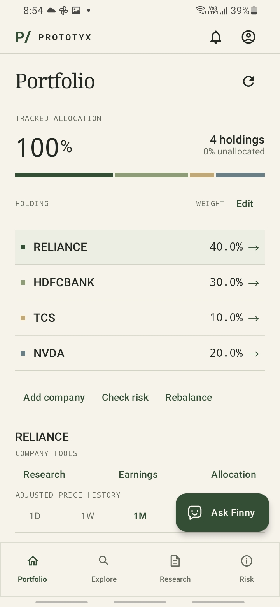
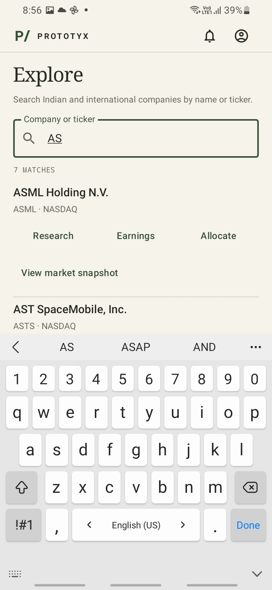
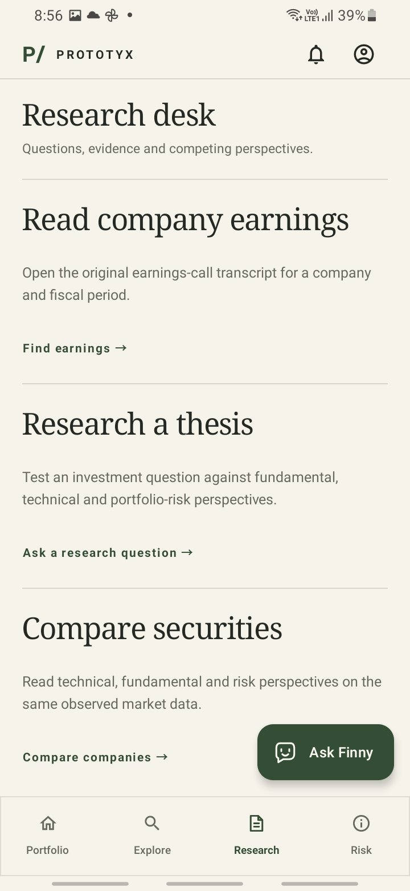
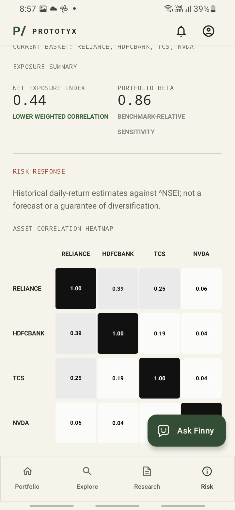
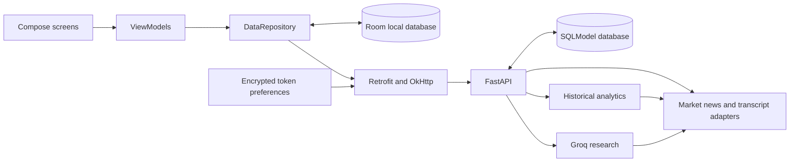

# Prototyx

**Portfolio allocation, market research and historical risk analysis in one Android app.**

Prototyx combines a Kotlin/Jetpack Compose client with a Python FastAPI backend. Track allocation weights, discover Indian and international companies, read dated headlines and original earnings transcripts, compare research perspectives, and inspect how holdings behave together. FINNY provides a conversational research interface with device speech recognition and text-to-speech.

This README describes the implementation reviewed on **29 October 2026**. Provider access and deployment availability depend on configuration; screenshots illustrate captured app states, not independently verified investment outcomes.

## App screenshots

### Portfolio and company discovery

<p>
  
  
</p>

### Research and historical risk

<p>
  
  
</p>

Screenshots supplied by the project team. Values are examples from the captured portfolio. The risk screen uses historical estimates; they are not forecasts or guarantees of diversification.

## Features

- **Portfolio allocations:** save holdings as decimal weights, edit or remove positions, restore account holdings and synchronize with the backend. Total allocation cannot exceed 100%.
- **Company discovery:** search names and tickers, retain exchange identifiers and open company research, earnings and allocation tools. Provider-backed search supplements a local catalog.
- **Market snapshots:** dated closing prices, moving averages, RSI and available valuation fields from Yahoo Finance through yfinance. Charts support 1D, 1W, 1M, 1Y and 5Y views.
- **Portfolio news:** dated Google News RSS headlines matched to company aliases, with publisher attribution and source links. Sentiment and portfolio impact are explicitly unassessed.
- **Research perspectives:** one Groq request presents technical, fundamental and risk perspectives on supplied market observations. This is a simulated committee, not independently researching analysts.
- **FINNY consultation:** identifies an asset, gathers market observations and DuckDuckGo search snippets, and generates a short research response. Missing verified price data prevents recommendation generation.
- **Earnings:** retrieves original raw transcripts through ROIC.ai for a company and fiscal period, subject to credentials, coverage and plan entitlement.
- **Risk mesh:** historical correlations, benchmark-relative beta, weighted correlation exposure and warnings for asset pairs above 0.70 correlation.
- **Minimum-variance allocation:** long-only, fully invested weights calculated from historical covariance with SciPy SLSQP.
- **Stress replay:** applies current normalized weights to selected historical 2022 market windows and reports historical return, drawdown and daily loss quantiles.
- **Account controls:** profile editing, password changes, session revocation, recovery email, data export and password-confirmed deletion.
- **Device features:** optional biometric/device-credential lock, local portfolio-review reminders and FINNY voice interaction.

## Architecture



Room exposes local holdings reactively. Market indicators have a 30-minute freshness window. Holding updates write locally and then send the complete holdings map to the backend. The server deletes omitted symbols and upserts positive weights; this is **full-state synchronization**, without a multi-device revision/conflict protocol. A failed network request can leave local and remote states different.

The consultation route uses synchronous provider calls inside asynchronous functions. The current use of `asyncio.gather` should not be interpreted as fully nonblocking parallel execution.

## Analytical methods and boundaries

### Historical data

The shared history module downloads adjusted daily prices, aligns observed dates and requires at least 60 finite daily returns. Analysis supports USD and INR base currencies, with historical FX conversion when necessary. Mixed-currency analysis defaults to USD. Market observations can be delayed or unavailable and are not executable quotes.

### Risk mesh

Weights are normalized to sum to one. The exposure index is `wᵀ C w`, where `C` is the historical correlation matrix. It describes weighted correlation, not monetary loss or volatility. Portfolio beta is a weighted combination of asset betas against `^NSEI` or `^GSPC`. Unallocated cash is not represented explicitly after weight normalization.

### Optimization

The implemented objective minimizes `wᵀ Σ w` with `sum(w) = 1` and `0 <= w[i] <= 1`. Daily means and covariance are annualized using 252 sessions. Reported Sharpe assumes a zero risk-free rate.

Optional return views affect reported return estimates, **not minimum-variance weights**. Maximum-Sharpe optimization, an efficient-frontier sweep and Black-Litterman are not implemented. The committee currently returns no implied return views. The returned allocation explanation is deterministic methodology text.

### Stress and portfolio summaries

Stress results replay historical windows rather than predict hypothetical macro shocks. The rolling five-year history request must still include the selected 2022 window. FINNY's portfolio health score is a concentration-only summary based on the largest normalized holding; it does not assess overall investment quality or learn a market regime.

## Technology

- **Android:** Kotlin 2.3.20, Jetpack Compose, Navigation 3, Room, StateFlow and coroutines.
- **Build:** Android Gradle Plugin 9.0.1, compile/target SDK 36, minimum SDK 24, Java 17 toolchain.
- **Networking and device security:** Retrofit, OkHttp, AndroidX Security Crypto, Biometric and WorkManager.
- **Backend:** FastAPI, Uvicorn, SQLModel, SQLite by default, PostgreSQL support.
- **Analytics:** NumPy, pandas, SciPy and yfinance.
- **External services:** Groq, Google News RSS, DuckDuckGo Search, ROIC.ai and configured recovery-email delivery.

Versions above are repository declarations. Python requirements are currently unpinned.

## Repository structure

```text
android/
  app/src/main/java/com/example/prototyx/
    data/              Repository, models, Room, networking and token storage
    notifications/     Local reminders and inbox
    ui/                Screens, components, ViewModels and voice assistant
    theme/             Colors, typography and app theme
  app/src/test/        Local unit tests
  app/src/androidTest/ Device and Compose tests
backend/
  app.py               Routes, authentication dependency and holdings sync
  account_api.py       Account lifecycle, recovery and account web pages
  auth_utils.py        Bcrypt hashing, JWT creation and credential versions
  database.py          SQLModel engine and schema initialization
  models.py            Persistence and API models
  agents/              Committee and FINNY consultation
  data/                Company, price, news, screener and transcript adapters
  quant/               Historical returns, risk mesh and optimizer
  test_*.py            Backend tests
  ACCOUNT_SETUP.md     Recovery-email and notification operations
  requirements.txt
 docs/screenshots/     App screenshots used in this README
```

## Run the backend

Use Python 3.10+ with a clean virtual environment. The previously inspected development environment used Python 3.11; dependency compatibility should be checked for your chosen version.

```powershell
git clone https://github.com/MaxasOP/Prototyx.git
cd Prototyx/backend
python -m venv .venv
.\.venv\Scripts\Activate.ps1
python -m pip install -r requirements.txt
```

Create `backend/.env` with your own values. Never commit this file.

```dotenv
SECRET_KEY=replace-with-a-private-random-secret-of-at-least-32-characters
DATABASE_URL=sqlite:///./prototyx.db
GROQ_API_KEY=your-groq-key
GROQ_MODEL=your-supported-groq-model-id
ROIC_API_KEY=your-roic-key
PUBLIC_APP_URL=https://prototyx.onrender.com
```

`SECRET_KEY` is required at startup. Groq and ROIC credentials are needed only for their corresponding features. Set a model supported by your Groq account; the source default is `qwen/qwen3.8-27b`, whose continued availability is not guaranteed by this README. OpenRouter is not used by the current committee or consultation implementation.

For recovery email, configure `MAIL_FROM` and `RESEND_API_KEY`, or the TLS SMTP settings documented in [account setup](backend/ACCOUNT_SETUP.md). Recovery is unavailable until a delivery method is configured.

```powershell
uvicorn app:app --host 0.0.0.0 --port 8000 --reload
```

Local API documentation: <http://localhost:8000/docs>. The configured hosted destination is <https://prototyx.onrender.com>; this link is not an uptime claim. `PORT` defaults to 8000 when starting `app.py` directly.

For PostgreSQL, supply a suitable `DATABASE_URL`. Schema initialization uses `create_all`; versioned migrations and database backup/restore procedures need to be planned for production.

## Run the Android app

1. Open `android/` in Android Studio with SDK 36 and a Java 17 toolchain.
2. Sync Gradle and run on an Android API 24+ device or emulator.
3. The default backend URL is `https://prototyx.onrender.com/`, configured in `data/network/RetrofitInstance.kt`.
4. For a local emulator, use the full URL `http://10.0.2.2:8000/` when calling `updateBaseUrl`. A bare host with an existing port can produce a duplicated port.
5. The manifest blocks cleartext HTTP. Use HTTPS or a deliberate debug-only network-security policy for local HTTP development; keep release traffic protected.

Voice requires microphone permission and a compatible Android speech service. Reminder delivery requires notification permission where applicable and can be delayed by device battery policies. Reminders are local portfolio-review prompts, not real-time market alerts.

## API guide

### Public endpoints

- `POST /api/auth/register`, `POST /api/auth/login`
- `GET /api/auth/recovery-status`
- `POST /api/auth/forgot-password`, `POST /api/auth/reset-password`
- `GET /api/tickers/search`, `GET /api/screener/search`
- `GET /api/market/indicators/{ticker}`, `GET /api/market/chart/{ticker}`
- `GET /api/news/sentiment`
- `POST /api/quant/risk-mesh`, `POST /api/quant/optimize`, `POST /api/quant/stress-test`
- `GET /`, `/legal/privacy`, `/legal/terms`, `/account/reset`, `/account/delete`

### Bearer-token endpoints

- `GET /api/holdings`, `POST /api/holdings/sync`
- `POST /api/agents/debate`, `POST /api/agents/consult`
- `GET /api/earnings/transcript/{ticker}`
- `GET /api/finny/strategy-report`, `GET /api/status`
- `GET /api/account`, `POST /api/account/profile`
- `POST /api/account/password`, `POST /api/account/signout-all`
- `GET /api/account/export`, `POST /api/account/delete`, `POST /api/auth/logout`

Login accepts a JSON email/password body. Protected calls use `Authorization: Bearer <token>`. Holdings sync accepts `{"holdings":{"AAPL":0.4,"MSFT":0.6}}`; sending an empty map clears holdings. Transcript requests accept `year` and `quarter`; select these explicitly rather than relying on fixed defaults.

## Security and data handling

Passwords are hashed with bcrypt. HS256 access tokens expire after seven days by default, carry unique identifiers and are checked against credential versions and revoked-token records. Password changes invalidate prior sessions. Recovery codes are hashed, expire after 30 minutes and are single-use. Authentication attempt limits are in-process and do not coordinate across multiple workers.

Android stores tokens in encrypted preferences, disables app backup and disables HTTP logging. If encrypted storage is unavailable, authentication falls back to memory for that session. Room holdings storage should not be assumed to be encrypted.

Provider failures generally produce explicit errors. The application does not guarantee automatic AI or synthetic-data fallbacks. Public analytics endpoints may perform expensive provider requests; deployment-level workload limits, observability and reproducible dependency pins remain areas for hardening.

## Tests and verification

Run the isolated suites from `backend/` after installing the dependencies and a compatible FastAPI test client dependency:

```powershell
python -m unittest test_integrity test_account test_company_search test_news -v
```

The integrity and account suites use an isolated database rather than the deployed database. Scripts named `live_smoke.py` and `live_account_smoke.py` are separate live-service checks; review their configuration before running them.

During the report review on 29 October 2026, six company-search tests and three news tests passed. The integrity and account modules could not load because the inspected virtual environment lacked `sqlmodel`. This is an incomplete environment check, not a passing full backend suite. Android unit and instrumentation tests are present but were not rerun for this documentation update.

## Team contributions

- **Hardik:** business logic, UI development and application-side workflows, including mobile interactions and portfolio state handling.
- **Krris:** AI integration and the FINNY chatbot/voice co-pilot experience, connecting conversational queries with the research workflow.
- **Manas:** backend development and cross-system integrations; sourced analytics and provider connections; account security, recovery and data controls; company discovery, news filtering, allocation validation and final application, research and speech integration refinements.

Responsibilities overlap across integrated features. The [commit history](https://github.com/MaxasOP/Prototyx/commits/master/) records Git authorship separately. Some older commit bodies explicitly identify themselves as simulated development history for project review; treat those as labeled review records rather than independently verified development dates.

## Current scope

Prototyx is a research and allocation-review application. Brokerage execution, custody, a transaction ledger, Black-Litterman, independently researching analyst agents and automated market-regime learning are not implemented in the inspected flows. Historical statistics and AI responses do not guarantee future returns or suitability.

No root LICENSE file is present in the inspected repository; the previous README's MIT-license claim should not be relied on until an explicit license is added by the project owners.
